<h1>
  Hi, I'm Juan José
  
</h1>

 

  

I build **AI agents and automations that turn hours of manual work into minutes**, and I know how to take a product from the first line of code to real customers.

## Bocati

  

  
  &nbsp;
  

## Tech stack

<table>
  <tr>
    <td valign="top" width="50%">
      <b>Languages</b>  
      
      
      
      
    </td>
    <td valign="top" width="50%">
      <b>AI &amp; Automation</b>  
      
      
      
      
      
      
      
      
    </td>
  </tr>
  <tr>
    <td valign="top">
      <b>Web &amp; Mobile</b>  
      
      
      
      
      
    </td>
    <td valign="top">
      <b>Cloud, Data &amp; Tools</b>  
      
      
      
      
      
      
    </td>
  </tr>
</table>

## Featured projects

<table>
  <tr>
    <td valign="top" width="33%">
      <a href="https://github.com/jjvelezo/Travelling-salesman-problem"><b>Travelling Salesman · Simulated Annealing</b></a> 
      🥇 1st of 40, shortest route in a timed competition. Multiple algorithms and parallelization strategies.  
      <code>C++</code> <code>Java</code> <code>Python</code>
    </td>
    <td valign="top" width="33%">
      <a href="https://github.com/jjvelezo/P2P-No-estructurado-st0263"><b>Unstructured P2P Network</b></a> 
      File-sharing system with concurrent transfers, built as microservices talking over gRPC on AWS.  
      <code>Java</code> <code>gRPC</code> <code>AWS</code>
    </td>
    <td valign="top" width="33%">
      <a href="https://github.com/jjvelezo/DetectorRostro"><b>Parallel Face Detection</b></a> 
      Face detector that parallelizes image processing to speed it up.  
      <code>C++</code> <code>OpenCV</code> <code>OpenMP</code>
    </td>
  </tr>
</table>
